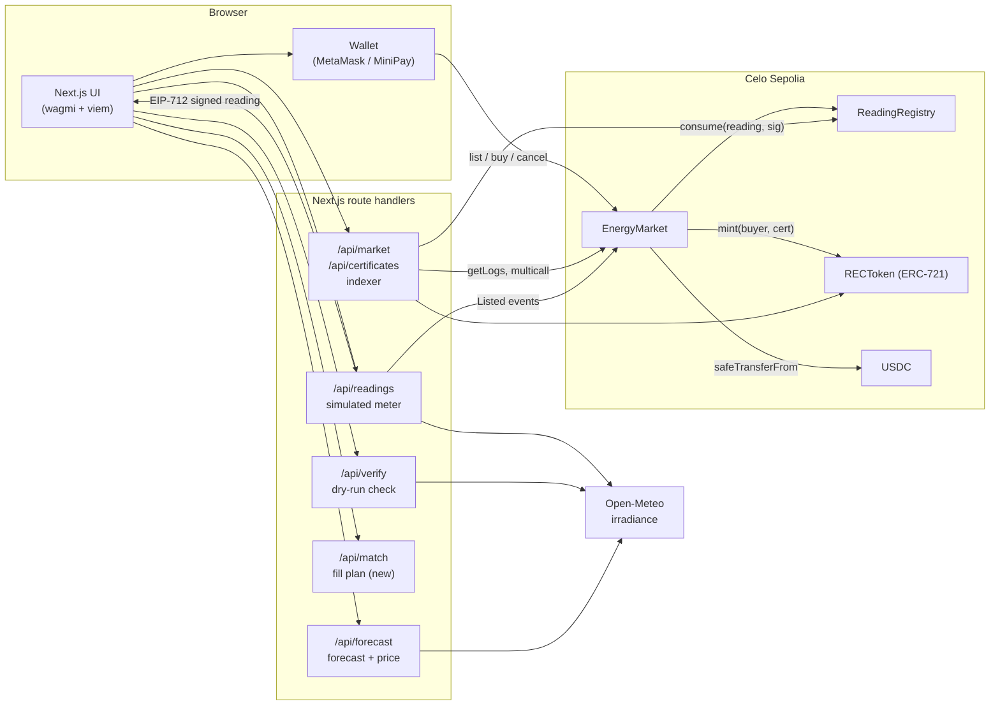

# Sunpool architecture

How the pieces fit, what each contract is allowed to do, and where the demo is simulated. Everything here is checked against the source; file paths are given so you can verify.

## 1. System overview

Sunpool has three layers: a Next.js app (UI plus server route handlers), three Solidity contracts on Celo Sepolia, and two external data sources (the Celo RPC and Open-Meteo).



ASCII version:

```
                        ┌──────────────── Browser ─────────────────┐
                        │  Next.js UI (wagmi + viem)  ◀──▶ Wallet   │
                        └───┬───────────┬───────────┬──────────┬───┘
                            │           │           │          │ list / buy / cancel
              POST /readings│  /verify  │ /forecast │ /market  │
                            ▼           ▼  /match   ▼ /certs   ▼
                 ┌────────────────── Next.js route handlers ──────────────┐
                 │ simulated meter ── verification ── forecast ── indexer  │
                 │   (signs EIP-712)    (rules)       (+ match)   (polling)│
                 └───┬──────────────────┬────────────────────────┬────────┘
                     │ Open-Meteo       │ Listed events          │ getLogs / multicall
                     ▼ (irradiance)     ▼                        ▼
              ┌────────────────────── Celo Sepolia ───────────────────────┐
              │  EnergyMarket ──consume()──▶ ReadingRegistry (EIP-712,     │
              │       │                       consumed-once)               │
              │       ├──mint()──▶ RECToken (ERC-721)                      │
              │       └──safeTransferFrom──▶ USDC: buyer ⇒ seller          │
              └────────────────────────────────────────────────────────────┘
```

Chain interaction split:

- **Writes** (list, buy, cancel, token approval) are sent from the user's wallet, directly to the contracts. The server never holds a user's funds or keys.
- **Reads** for the UI go through the server indexer (`/api/market`, `/api/certificates`), which caches event scans between requests.
- **The server holds one key**, the simulated meter key (`METER_SIGNER_PRIVATE_KEY`). It can only sign readings; it cannot move funds or call admin functions.

## 2. Contracts

Source: `contracts/`. Solidity `^0.8.28`, OpenZeppelin 5, built and tested with Hardhat 3 and viem. Deployed to Celo Sepolia (chain ID 11142220) via Hardhat Ignition (`ignition/modules/Sunpool.ts`, `ignition/modules/UsdcMarket.ts`). Addresses are in the [README](../README.md#deployed-contracts-celo-sepolia-chain-id-11142220).

### ReadingRegistry (`AccessControl`, `EIP712`)

Verifies meter-signed readings and records each reading ID as consumed once.

| Role | Held by | Can |
| --- | --- | --- |
| `DEFAULT_ADMIN_ROLE` | deployer | grant and revoke roles |
| `METER_ADMIN_ROLE` | deployer | `registerMeter(meterId, signer)`, `revokeMeter(signer)` |
| `CONSUMER_ROLE` | the `EnergyMarket` contract(s) | `consume(reading, signature)` |

- `verify` recovers the signer with `ECDSA.tryRecover` and reverts with `InvalidSignature`, `UnregisteredMeter`, `MeterMismatch` (signer is registered for a different meter ID) or `EmptyReading` (zero Wh or zero seller).
- `consume` checks `consumedAt[readingId]` first and reverts with `ReadingAlreadyConsumed(readingId, consumedAt)`, then verifies the signature, then stores `block.timestamp`.
- Only the market holds `CONSUMER_ROLE`, so nobody can burn a reading ID by calling `consume` directly.

### RECToken (`ERC721`, `AccessControl`)

One certificate per verified kWh batch. `Certificate { readingId, meterId, producer, timestamp, wh }` is stored on-chain; `tokenURI` returns fully on-chain base64 JSON (Wh, timestamp, meter ID, reading ID, producer).

- `MINTER_ROLE` is held by the market only. `mint` uses `_safeMint`.
- Certificates are ordinary ERC-721 tokens and transferable. There is no retirement or burn function; retiring a certificate for a sustainability claim is a production item (see section 10).

### EnergyMarket (`AccessControl`, `Pausable`, `ReentrancyGuard`)

| Role | Held by | Can |
| --- | --- | --- |
| `DEFAULT_ADMIN_ROLE` | deployer | grant and revoke roles |
| `PAUSER_ROLE` | deployer | `pause()` / `unpause()` |

- `list(reading, signature, pricePerKwh)`: caller must be `reading.seller` (`NotSeller`), price must be non-zero (`ZeroPrice`), then calls `registry.consume`. Listing is what consumes the reading. Blocked while paused.
- `buy(listingId, maxPricePerKwh)`: `nonReentrant` and `whenNotPaused`. Buys the whole listing. Reverts on inactive listing, `SelfPurchase`, or `PriceChanged` if the listed price exceeds the buyer's cap. Order of operations: mark inactive, `safeTransferFrom(buyer, seller, total)` (OpenZeppelin `SafeERC20`), mint certificate to the buyer, emit `TradeSettled`. The total is `wh * pricePerKwh / 1000`, rounded down (`quote`).
- `cancel(listingId)`: seller only, active listings only. The reading stays consumed, so cancelled energy cannot be relisted or certified.
- `stablecoin`, `registry` and `certificates` are `immutable`. The market settles in any ERC-20; the live market uses USDC (6 decimals) and a paused earlier market uses USDm (18 decimals).

Role wiring at deployment (`ignition/modules/Sunpool.ts`): the market gets `CONSUMER_ROLE` on the registry and `MINTER_ROLE` on RECToken, and the meter signer key is registered for meter `sunpool:demo-meter`. Two markets (USDm and USDC) share one registry and one RECToken, so a reading consumed in one is rejected by the other.

## 3. Signed readings (EIP-712)

The registry's EIP-712 domain is `name: "Sunpool ReadingRegistry"`, `version: "1"`, `chainId: 11142220`, `verifyingContract: <ReadingRegistry>`. The signed struct:

```
Reading(bytes32 readingId, bytes32 meterId, address seller, uint64 timestamp, uint64 wh)
```

The server mirrors the type definition in `src/lib/chain/contracts.ts` (`EIP712_DOMAIN`, `READING_TYPES`).

```
Seller UI        POST /api/readings          Verification           Seller wallet        Contracts
   │ {seller, wh, kWp} │                          │                       │                  │
   ├──────────────────▶│ verifyWithLiveData ─────▶│ (section 6.2)        │                  │
   │                   │◀─ accept / review / reject                       │                  │
   │                   │ reject ⇒ HTTP 422, nothing signed                │                  │
   │                   │ readingId = keccak256(seller, timestamp, 16 random bytes)           │
   │                   │ meter key signTypedData(Reading)                 │                  │
   │◀──{reading, signature, verification}                                 │                  │
   ├──────────────────────────────────────────────────────────────────────▶ list(reading, sig, price)
   │                                                                      │ ───────────────▶ │ consume(): verify sig,
   │                                                                      │                  │ mark ID consumed
```

Guards in `/api/readings` before signing: seller must be an address; Wh is an integer between 100 and 10,000; at most 25 readings per seller per day per server instance (in-memory); the verification verdict must not be `reject`; and if today's listings cannot be read from Celo, it fails closed (HTTP 503) rather than signing.

Honest status: the energy figure is whatever the seller asks for, bounded by the verification check. Nothing is measured. In production the meter signs on the device (section 10).

## 4. Double-claim guarantee

A kWh batch is identified by `readingId`. The guarantee has three parts:

1. **Consumption is atomic with listing.** `EnergyMarket.list` calls `ReadingRegistry.consume`, which writes `consumedAt[readingId]` in the same transaction. If a second `list` uses the same reading ID, `consume` reverts with `ReadingAlreadyConsumed` and the whole transaction is undone.
2. **Only one path mints.** A certificate is minted only inside `EnergyMarket.buy`, from the listing's stored reading, and a listing is single-use (`active` flips to false before payment and minting). One reading therefore yields at most one listing, at most one purchase, at most one certificate.
3. **The registry is shared.** Because the registry (not the market) holds the consumed set, a second market pointed at the same registry also rejects the reading. The two deployed markets demonstrate this.

The `/double-claim` page replays a reading that is already consumed on Celo Sepolia (`src/lib/chain/double-claim-fixture.json`) against the live contract and shows the rejection, with no wallet needed. Contract tests cover the same behaviour (section 9).

What the guarantee does not cover: it ensures a *signed reading* is used once; it cannot tell whether the reading reflects real energy. That is the meter-trust problem in [`THREAT_MODEL.md`](THREAT_MODEL.md).

## 5. Seeded fallback path

The app has two data sources, selected by `NEXT_PUBLIC_DATA_SOURCE` or the `?source=` URL parameter (`src/hooks/use-data-source.ts`, `src/lib/chain/contracts.ts`):

- `chain`: reads and writes Celo Sepolia through the indexer and the wallet.
- `seeded`: no network needed. 14 named Surulere households, deterministic PRNG, simulated clock and trade stream (`src/lib/seed.ts`). `?state=live|empty|error` forces states for recording.

In code, `DATA_SOURCE` is `"seeded"` only when the env var is exactly `seeded`; otherwise it is `chain`. The seeded path is kept working so the demo can run when the RPC or a wallet is unavailable. The forecast route also falls back to the seeded price band when fewer than 5 on-chain trades exist.

## 6. AI layer

Server-side TypeScript in route handlers. It is deliberately transparent and rule-based: no trained model, no ML dependency. All thresholds are exported constants.

### 6.1 Forecast and price suggestion (`src/lib/forecast.ts`, `GET /api/forecast`)

- Input: hourly global horizontal irradiance and cloud cover for Surulere (6.50 N, 3.35 E) from Open-Meteo (`src/lib/irradiance.ts`, cached 30 minutes, 3 s timeout).
- Rooftop generation per hour = kWp x GHI/1000 x performance ratio 0.8. The confidence band is +/-(10% + 3% per hour ahead + up to 25% for cloud cover).
- If Open-Meteo fails, a modeled clear sky is used (75% of clear sky, band 30-100% of clear sky) and the response says so in `source` and `sourceNote`.
- Price suggestion: median of the last 20 trades (on-chain trades if at least 5 exist, otherwise the seeded price band), adjusted by at most +/-5% from next-hour neighbourhood supply versus buyer demand. The response includes the reason in plain language.
- The Market chart uses a separate modeled series (`buildGenerationSeries`): clear-sky curve x weather factor, corrected by an exponentially smoothed (alpha = 0.3) ratio of actual to forecast output, with a widening band. It is labelled as simulated.

### 6.2 Reading verification (`src/lib/verify.ts`, `src/lib/verify-server.ts`, `POST /api/verify`)

Rule-based anomaly check run before the meter key signs (`/api/readings`) and as a dry run (`/api/verify`, nothing signed).

- **Time of day:** no new surplus before sunrise or after sunset (hard reject); low sun near the edges adds risk.
- **Physical limit:** most a roof could spare so far today = kWp x irradiation since midnight / 1 kW/m2 x 0.8 - 300 W self-consumption x daylight hours. The new reading plus the seller's `Listed` Wh since WAT midnight must fit (hard reject). The seller's Wh comes from `Listed` events on Celo (`src/lib/chain/listings.ts`, 7-day window, cached), so it survives restarts.
- **Neighbours:** z-score of the request against recent listings by other sellers, used only with at least 5 peers.
- **Risk** = 0.60 x share of limit used + 0.25 x outlier score + 0.15 x low sun. Reject on a hard rule or risk >= 0.70; 0.40-0.70 is signed but flagged `review`; below 0.40 is `accept`.
- Rooftop size (1-15 kWp) is declared by the seller in the demo; this is a known gap (see the threat model).

### 6.3 Matching (`GET /api/match`) - added this week

Endpoint `GET /api/match?kwh=&maxPrice=&source=&only=` (see `src/app/api/match/route.ts`; logic in `src/lib/match.ts`, unit-tested). It takes a buyer's request for energy and returns a ranked fill plan: the whole listings that cover the requested kWh at the lowest total score-weighted cost (an exhaustive subset search for up to 14 offers, greedy cheapest-first beyond that), with a plain-language reason for each pick or skip. It reads the same open listings as the market snapshot. It does not move funds or sign anything: because `EnergyMarket.buy` buys a whole listing, the buyer still sends each purchase from their own wallet.

## 7. Indexer and polling

There is no database. The indexer is a module-level cache in a route handler (`src/lib/chain/server.ts`):

- **Trades:** `getLogs` for `TradeSettled` on the market, scanned in chunks of 99,000 blocks (Forno rejects ranges above 100,000). The cache remembers `scannedTo`, so each poll scans only new blocks. Concurrent callers share one scan (`syncTrades`) so rows are never duplicated.
- **Listings:** `listingCount` then one `multicall` of `getListing` for every ID; inactive ones are filtered out.
- **Timestamps:** Celo blocks are one second apart, and Forno only serves `eth_getBlockByNumber` for roughly the last 10,000 blocks, so older event times are derived from the head block (`BLOCK_TIME_SECONDS = 1`).
- **Certificates:** `/api/certificates` joins RECToken data with the cached trades and checks `ReadingRegistry.consumedAt` per reading (`src/lib/chain/certificates.ts`).
- **Client polling:** the market polls `/api/market` every 5 s (`use-chain-market.ts`); the ledger polls `/api/certificates` every 30 s. Responses carry short `Cache-Control` headers (`s-maxage` of 3 s for the market, 10 s for certificates).
- **Limits:** the cache lives in one server instance's memory; on a serverless cold start it rescans from `deployBlock`. Fine for a demo, replaced by a real indexer in production.

## 8. Config and environment

Network constants live in one file, `src/lib/chain/celo.ts`, with doc sources and the date they were checked. Contract addresses and the first block to scan are in `src/lib/chain/contracts.ts`, with env overrides.

| Variable | Used by | Purpose |
| --- | --- | --- |
| `DEPLOYER_PRIVATE_KEY` | `npm run contracts:deploy` | Testnet-only deployer key |
| `METER_SIGNER_PRIVATE_KEY` | `/api/readings` | Simulated meter key; its address must be registered in `ReadingRegistry` |
| `NEXT_PUBLIC_READING_REGISTRY_ADDRESS`, `NEXT_PUBLIC_REC_TOKEN_ADDRESS`, `NEXT_PUBLIC_ENERGY_MARKET_ADDRESS` | app | Override the built-in Celo Sepolia addresses after a redeploy |
| `NEXT_PUBLIC_DEPLOY_BLOCK` | indexer | First block to scan (defaults to the USDC market deployment block) |
| `NEXT_PUBLIC_DATA_SOURCE` | app | `seeded` for the offline demo; anything else (or unset) means `chain` |

Secrets go in `.env.local` (git-ignored); `.env.example` has placeholders only.

## 9. Testing

| Suite | Command | Coverage |
| --- | --- | --- |
| Contracts, 20 tests (`test/EnergyMarket.ts`, Hardhat 3 + viem, `node:test`) | `npm run contracts:test` | Double-claim rejection, bad and unregistered signatures, settlement math, access control, pausing |
| Unit, 19 tests (`src/lib/verify.test.ts`, `node:test` via tsx) | `npm run test:unit` | Reading verification rules and scoring |
| Types and lint | `npm run typecheck` (tsc, Hardhat compile, tsc for tests), `npm run lint` | |
| Build | `npm run build` | |

The forecast logic has no dedicated unit tests; it is exercised through the app.

## 10. Deployment

- **App:** Vercel (`https://sunpool-gamma.vercel.app`). The route handlers run as serverless functions with the env variables above set in the Vercel project.
- **Contracts:** Celo Sepolia via `npm run contracts:deploy` (Hardhat Ignition, `ignition/parameters/celoSepolia.json`; the USDC market uses `ignition/modules/UsdcMarket.ts` with `celoSepolia-usdc.json`, reusing the existing registry and certificate token). Source is verified on Blockscout. After any contract change run `npm run contracts:abis` to refresh `src/lib/chain/abis.ts`.
- **Settlement token:** USDC on testnet because test USDm is practically unobtainable (see README); mainnet would use USDm (formerly cUSD) or USDC.

## 11. Production path

| Today (demo) | Production |
| --- | --- |
| Server-side simulated meter key, screened by the verification rules | One key per certified smart meter or inverter, signing on the device; registered and revoked through `METER_ADMIN_ROLE` |
| Seller-declared rooftop size | Size and meter registered by an operator at onboarding |
| Celo Sepolia, test USDC | Celo mainnet, USDm or USDC (both supported in MiniPay) |
| One neighbourhood market | One `EnergyMarket` per estate or mini-grid, sharing one registry and certificate token |
| Whole-listing purchases; matching returns a plan the buyer executes | Partial fills, standing buy orders, auto-listing of forecast surplus |
| In-memory polling indexer | Event indexer (The Graph, SubQuery or similar) |
| Single admin key for roles and pausing | Multisig or timelock for admin roles |
| Transferable certificates, no retirement | Retirement/burn flow and registry-grade reporting for sustainability claims |

Security assumptions and open risks: [`THREAT_MODEL.md`](THREAT_MODEL.md). No audit has been done.
